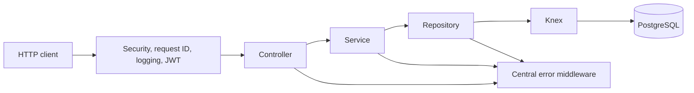

# Vehicle Rental Management API

A REST API built with Node.js, Express, TypeScript, Knex, and PostgreSQL. It includes staff authentication, vehicle management, conflict-safe rental booking, image uploads, monthly financial reporting, Swagger documentation, and integration tests.

> Complete installation and running guide: choose either the Docker one-command setup or the pure Node.js setup below.

## Option 1: Run with Docker — easiest, one command

Use this option if Docker is installed. You do not need to install Node.js, npm, or PostgreSQL separately.

### 1. Confirm Docker is installed

Run:

```bash
docker --version
docker compose version
```

Both commands must print version information. If either command is unavailable, install and start Docker Desktop, then reopen the terminal.

Also make sure ports `3000` and `5432` are not already being used by another application.

### 2. Start the complete application

From the project root, run this single command:

```bash
docker compose up --build
```

Or, if GNU Make is installed:

```bash
make dev
```

This command automatically:

1. Builds the TypeScript application in a multi-stage Docker image.
2. Starts PostgreSQL 15.
3. Waits until PostgreSQL passes its health check.
4. Runs all Knex database migrations.
5. Runs the staff, vehicle, and rental seeders.
6. Starts the API in TypeScript watch mode on port `3000`.

The Compose API service uses the Dockerfile's `development` target, which includes `tsx` and
mounts the source folders. It builds once for migration compatibility and then starts `npm run dev`
automatically. Running `docker compose exec api npm run dev` is also supported.

Wait until the terminal displays:

```text
Server running on http://localhost:3000
Swagger Docs available at http://localhost:3000/api-docs
```

The application is now available at:

- API base URL: `http://localhost:3000/api/v1`
- Health endpoint: `http://localhost:3000/api/v1/health`
- Swagger UI: `http://localhost:3000/api-docs`

### 3. Seeded login

Use the following account:

```text
Email: admin@rental.local
Password: Admin123!
```

### 4. Useful Docker commands

Start the existing containers without rebuilding:

```bash
docker compose up
```

Run migrations manually:

```bash
docker compose exec api npm run db:migrate
```

Run seeders manually:

```bash
docker compose exec api npm run db:seed
```

Rollback the latest migration batch, migrate again, and reseed:

```bash
make db-reset
```

Without Make, run:

```bash
docker compose exec api sh -c "npm run db:rollback && npm run db:migrate && npm run db:seed"
```

Follow API logs:

```bash
docker compose logs -f api
```

Stop the containers while preserving the database and uploaded files:

```bash
docker compose down
```

Delete the containers and all persisted Docker data:

```bash
docker compose down --volumes
```

The last command permanently removes the Docker database and uploaded vehicle images.

## Option 2: Run with Node.js and PostgreSQL

Use this option when Docker is not installed or when running the API directly for development.

### 1. Install prerequisites

Install:

- Node.js 20 or newer
- npm
- PostgreSQL 15 or a compatible newer version

Confirm the installations:

```bash
node --version
npm --version
psql --version
```

Make sure the PostgreSQL server is running.

### 2. Install project dependencies

Open a terminal in the project root and run:

```bash
npm install
```

### 3. Create the PostgreSQL database

Using `psql`:

```bash
psql -U postgres -c "CREATE DATABASE vehicle_rental;"
```

If the database already exists, PostgreSQL will report that it exists and you can continue.

You can also create a database named `vehicle_rental` using pgAdmin or another PostgreSQL client.

### 4. Create and configure `.env`

macOS/Linux:

```bash
cp .env.example .env
```

Windows PowerShell:

```powershell
Copy-Item .env.example .env
```

Open `.env` and set the correct local values:

```env
PORT=3000
DB_HOST=localhost
DB_PORT=5432
DB_NAME=vehicle_rental
DB_USER=postgres
DB_PASSWORD=your_postgres_password
DB_POOL_MIN=2
DB_POOL_MAX=10
JWT_SECRET=replace-with-a-secure-random-secret-at-least-32-characters
UPLOAD_DIR=uploads
```

`JWT_SECRET` must contain at least 32 characters. Do not commit the `.env` file.

### Environment variable reference

| Variable      | Required | Default       | Purpose                                                            |
| ------------- | -------- | ------------- | ------------------------------------------------------------------ |
| `NODE_ENV`    | No       | `development` | Runtime mode: `development`, `test`, or `production`.              |
| `PORT`        | No       | `3000`        | HTTP port exposed by the Express server.                           |
| `DB_HOST`     | Yes      | —             | PostgreSQL hostname; use `postgres` inside Docker Compose.         |
| `DB_PORT`     | No       | `5432`        | PostgreSQL server port.                                            |
| `DB_NAME`     | Yes      | —             | Application database name.                                         |
| `DB_USER`     | Yes      | —             | PostgreSQL login role.                                             |
| `DB_PASSWORD` | Yes      | —             | Password for the PostgreSQL role.                                  |
| `DB_POOL_MIN` | No       | `2`           | Minimum number of Knex pool connections.                           |
| `DB_POOL_MAX` | No       | `10`          | Maximum pool connections; must be at least `DB_POOL_MIN`.          |
| `JWT_SECRET`  | Yes      | —             | HMAC secret used to sign and verify JWTs; minimum 32 characters.   |
| `UPLOAD_DIR`  | No       | `uploads`     | Local upload root; vehicle photos use its `vehicles` subdirectory. |

Configuration is validated at startup. The process exits before accepting requests if a required
value is missing, a number is outside its allowed range, or the pool bounds are invalid. The
committed `.env.example` contains development placeholders; deployments must provide real secrets.

### 5. Run database migrations

For source-based local development, run:

```bash
npm run db:migrate:dev
```

This creates the `staff`, `vehicles`, and `rentals` tables, indexes, foreign keys, enum, and database constraints.

To rollback the latest migration batch:

```bash
npm run db:rollback:dev
```

### 6. Seed the database

Run:

```bash
npm run db:seed:dev
```

The seeders are repeatable and create:

- The administrator account shown above
- Sample vehicles
- Sample rentals
- A July 29–August 3 cross-month rental for report verification

### 7. Start the development server

Run:

```bash
npm run dev
```

The development server watches TypeScript files and restarts automatically after changes.

Open:

```text
http://localhost:3000/api/v1/health
http://localhost:3000/api-docs
```

### 8. Build and run compiled production code locally

Build TypeScript:

```bash
npm run build
```

Run compiled migrations and seeds:

```bash
npm run db:migrate
npm run db:seed
```

Start the compiled application:

```bash
npm start
```

The non-`:dev` database scripts use the compiled migrations and therefore require `npm run build` first.

## Running integration tests

Integration tests require a separate PostgreSQL database. The setup process rolls back, migrates, and seeds this database before running tests.

### 1. Create the test database

```bash
psql -U postgres -c "CREATE DATABASE vehicle_rental_test;"
```

### 2. Configure test database values when defaults do not match

The available variables are documented in `.env.test.example`:

```env
TEST_DB_HOST=localhost
TEST_DB_PORT=5432
TEST_DB_NAME=vehicle_rental_test
TEST_DB_USER=postgres
TEST_DB_PASSWORD=postgres
JWT_SECRET=test-jwt-secret-that-is-at-least-32-characters
```

Set these as environment variables before running tests if your PostgreSQL credentials differ. The test harness refuses to reset any database whose name does not end with `_test`.

### 3. Run tests

```bash
npm test
```

Or:

```bash
make test
```

The integration suites verify authentication, vehicle CRUD and photo serving, overlap rejection,
update and cancellation behavior, two-request booking concurrency, inclusive daily pricing, and
historically accurate cross-month reporting.

## Project architecture



- **Controllers** parse HTTP requests and format responses.
- **Services** validate domain data and implement business rules and transactions.
- **Repositories** contain Knex and SQL database operations.
- **Routes** manually create and inject repositories, services, and controllers.
- **Middleware** provides Helmet, CORS, request IDs, Pino logging, JWT authentication, login rate limiting, validation, file uploads, and centralized errors.

The layers have separate responsibilities:

1. A **route** declares the HTTP method, authentication, upload handling, and validators.
2. A **controller** reads typed request values and shapes the HTTP response.
3. A **service** owns business validation, pricing, availability, and transactions.
4. A **repository** owns Knex queries and raw SQL.
5. Central **error middleware** produces a consistent JSON error response.

Dependencies are constructed explicitly in route modules, keeping the application testable without
introducing a dependency-injection framework.

Vehicle photos are stored under `uploads/vehicles` and served from `/uploads/vehicles/<filename>`.
Only JPEG, PNG, and WebP files up to 5 MB are accepted. Replaced and failed uploads are cleaned up safely.

## Important booking behavior

Two inclusive rental periods overlap when:

```text
existing.start_date <= requested.end_date
AND
existing.end_date >= requested.start_date
```

The repository implements the rule with this predicate:

```sql
WHERE vehicle_id = :vehicle_id
  AND status <> 'cancelled'
  AND start_date <= :requested_end
  AND end_date >= :requested_start
```

The comparison is inclusive, so a request starting on an existing rental's `end_date` conflicts.
Cancelled rentals are excluded. Updates add `AND id <> :current_rental_id`, preventing the rental
from conflicting with itself. Availability is rechecked whenever the vehicle or dates change, or
when a previously cancelled rental becomes active again.

### Transaction and concurrency handling

Rental creation runs inside one Knex transaction:

1. Select the requested active vehicle using PostgreSQL `FOR UPDATE`.
2. Check for a non-cancelled overlap inside the same transaction.
3. Calculate the inclusive total using the locked vehicle's daily rate.
4. Insert the rental and commit.

Every booking attempt for the same vehicle locks the same row. If two requests arrive together, one
waits. After the first commits, the waiting transaction sees the new rental and returns `409
Conflict`. Bookings for unrelated vehicles remain independent.

Updates also run in a transaction. The rental row is locked first, and the target vehicle is locked
when booking fields change. Any exception rolls the transaction back automatically, preventing
partial changes or incorrectly calculated totals.

Rental pricing is calculated by the server using inclusive days:

```text
durationDays = max(1, ceil((endDate - startDate) / 86,400,000) + 1)
totalAmount = durationDays * vehicle.daily_rate
```

Clients cannot choose `total_amount`.

## Monthly report behavior

The report selects non-cancelled rentals that intersect the requested inclusive month:

```sql
r.status <> 'cancelled'
AND r.start_date <= month_end
AND r.end_date >= month_start
```

Each matching rental is clipped to the month boundaries:

```sql
GREATEST(r.start_date, month_start) AS effective_start,
LEAST(r.end_date, month_end) AS effective_end
```

Prorated values are then calculated using inclusive dates:

```sql
days_in_month = (effective_end - effective_start) + 1
booked_daily_rate = r.total_amount / ((r.end_date - r.start_date) + 1)
prorated_revenue = days_in_month * booked_daily_rate
```

Revenue comes from the rental's stored `total_amount`, not the vehicle's current `daily_rate`, so a
later fleet-rate change cannot rewrite historical revenue. A July 29–August 3 rental contributes
three August days and three days of its original booked revenue.

The query groups by vehicle and returns `total_bookings`, `days_rented`, and `revenue`. The service
also identifies `top_revenue_vehicle`. The optional `vehicle_id` filter is parameterized. Active
vehicles without activity return zero totals, while a soft-deleted vehicle remains in a historical
report if it had qualifying rental activity.

Example requests:

```http
GET /api/v1/reports/rentals?month=2026-08
GET /api/v1/reports/rentals?month=2026-08&vehicle_id=1
Authorization: Bearer <JWT>
```

The response includes per-vehicle bookings, rented days, revenue, and `top_revenue_vehicle` metadata.

## Swagger UI

After the application starts, open:

[http://localhost:3000/api-docs](http://localhost:3000/api-docs)

To call protected routes:

1. Open `POST /api/v1/auth/login` in Swagger.
2. Use the seeded administrator email and password.
3. Copy the returned JWT token.
4. Click **Authorize** at the top of Swagger UI.
5. Enter the token and confirm.
6. Execute the protected vehicle, rental, and report endpoints.

## Postman option

Import this collection into Postman:

[`docs/vehicle-rental-api.postman_collection.json`](docs/vehicle-rental-api.postman_collection.json)

Then:

1. Confirm the collection variable `baseUrl` is `http://localhost:3000/api/v1`.
2. Run **Auth → Login** first.
3. The Login test script automatically saves the returned JWT as `jwt_token`.
4. Run requests in the Vehicles, Rentals, and Reports folders.

The collection also maintains `vehicleId` and `rentalId` variables after supported create requests.

## Quality commands

```bash
npm run lint
npm run typecheck
npm run format:check
npm run build
npm test
```

The credentials and JWT secret in `docker-compose.yml` are for local review only. Replace them with deployment secrets before using the application outside a local environment.
